# Vernacular AI — Global Artisan Storefront

[](https://vernacular-storefront.onrender.com)
[](https://nextjs.org/)
[](https://react.dev/)
[](https://www.framer.com/motion/)
[](https://fastapi.tiangolo.com/)
[](https://developer.paypal.com/)
[](https://deepmind.google/technologies/gemini/)
[](https://supabase.com/)
[](https://developer.mozilla.org/en-US/docs/Web/Progressive_web_apps)
[](https://github.com/IamGeniusORG/Vernacular-AI)
[](https://www.typescriptlang.org/)
[](https://tailwindcss.com/)
[](#)
[](#)

> **Empowering rural Indian weavers with voice-first multimodal AI, localized digital boutiques, native-grade mobile app UX, 100% zero-commission domestic commerce, and global cross-border export powered by PayPal.**

---

## 💡 The Dual Hackathon Mission

India's traditional handloom sector sustains over **4.3 million weavers and artisans**, producing some of the world's finest hand-loomed textiles (Jamdani, Taant, Baluchari, Khadi, Tussar Silk). Despite their exceptional craftsmanship, over **80% of artisans remain excluded from digital and global commerce** due to:
1. **Linguistic & Literacy Barriers:** Mainstream platforms (Amazon, Etsy, Shopify) require English fluency, complex SKU spreadsheets, and manual text copywriting.
2. **Predatory Middlemen:** Aggregators and regional intermediaries take 30%–50% cuts, keeping rural weavers at subsistence income levels.
3. **Cross-Border Export Friction:** International shoppers crave authentic heritage textiles, but rural artisans cannot manage currency conversion, international merchant accounts, or export cataloging.

### Submission Alignment

| Track | Hackathon Focus | How Our Solution Delivers |
|---|---|---|
| 🇮🇳 **Seva First Innovation Challenge** | Rural Empowerment & Digital Inclusion | **Zero-Typing Studio:** Artisans snap a photo and record a voice description in their native language (Bengali/Hindi). **0% Platform Cut:** 100% direct-to-weaver UPI QR payments and WhatsApp commerce ensure every single rupee goes directly to the weaver. **Native-Grade PWA:** Zero mobile lag, optimistic UI updates, and offline resilience for low-bandwidth village conditions. |
| 🌍 **PayPal AI Hackathon** | Next-Gen AI & Global Cross-Border Commerce | **AI Global Pricing Engine:** Gemini 2.5 Flash analyzes weave complexity to generate fair domestic INR prices, premium USD export pricing (`price_usd`), and heritage storytelling (`export_description`). **PayPal React SDK:** International buyers checkout seamlessly with PayPal while artisans receive global funds straight to their linked PayPal account. |

---

## 🌟 Core Feature Suite

### 1. Multimodal Voice & Vision AI Cataloging (`/studio`)
* **Zero-Typing Camera Studio:** Artisans snap a photo of their handloom textile and speak naturally in their native dialect (Bengali, Hindi, or English).
* **Google Gemini 2.5 Flash Multimodal Engine:** Simultaneously inspects the garment photograph and spoken audio waveform to synthesize:
  * Multilingual titles and descriptions (English, Bengali, and Hindi).
  * Automated craft classification (weave technique, fabric, regional motif).
  * Fair domestic market valuation range in INR (`suggested_price_range`).
  * International boutique USD valuation (`suggested_usd_price`) and heritage narrative (`export_description`).
* **Supabase Media Storage CDN:** Automated compression and public delivery of product photos, weaver voice recordings, and profile assets.
* **Smart Edge Background Processing:** Background removal powered by lightweight `rembg-cpu` using `u2netp` (only ~4.7MB) with PIL compression and a 3.5s timeout circuit breaker, avoiding server memory exhaustion on restricted hosting environments.

### 2. Dual-Checkout Storefront UI (`/shop/[artisan_id]`)
* **Shipping Destination Toggle:** Shoppers choose their purchasing context:
  `[ 🇮🇳 Domestic (INR) ]  |  [ 🌍 International (USD) ]`
* **🇮🇳 Domestic Mode:**
  * Displays domestic INR price (`₹1,800`).
  * **Instant UPI Pay Modal (0% Fee):** Dynamically displays the artisan's real merchant QR code or synthesizes banking QR codes (`qrcode.react`) and mobile deep links (`upi://pay?pa=...`) launching GPay, PhonePe, Paytm, or BHIM.
  * **WhatsApp 1-Tap Commerce:** Direct WhatsApp conversation link with pre-filled item details and phone number normalization.
* **🌍 International Export Mode:**
  * Displays international USD price (`$45.00`) and the AI-generated heritage export narrative.
  * Hides domestic payment buttons.
  * Integrates the official `@paypal/react-paypal-js` SDK with lazy script loading (`deferLoading={destination !== "international"}`) for maximum page performance.
  * Captures orders into the artisan's linked `paypal_email` in the PayPal Sandbox environment.
* **Voice of the Weaver Audio Player:** Streams the artisan's original native voice note alongside the AI-translated text, establishing authenticity and emotional connection.
* **Masterpiece Showcase Carousel:** Randomized, infinitely sliding carousel highlighting the breadth of the weaver's portfolio.

### 3. Direct Patronage & "Tip the Artisan" Protocol
* **Direct Weaver Micro-Patronage:** Shoppers and cultural patrons can tip artisans directly from the public storefront and checkout modal with zero platform deduction.
* **Dual-Currency Support:**
  * **Domestic (INR):** Direct scan of the artisan's real UPI QR code or 1-tap mobile app launch (`upi://pay`). Enforces a strict minimum tip of ₹10 with an explicit badge and input validation.
  * **International (USD):** Secondary standalone PayPal `createOrder` integration utilizing `shipping_preference: "NO_SHIPPING"`, enabling friction-free tipping without requesting physical delivery addresses.
* **Patron Transparency Ledger:** Tips are logged to the Supabase `tips` table with patron names, currency, and payment method via `POST /api/v1/artisans/{artisan_id}/tip`.

### 4. Real Artisan Payment QR Code Integration
* **In-Studio Payment QR Upload:** Artisans upload screenshots of their personal PhonePe, Google Pay, Paytm, or BHIM QR codes in `/studio` (Branding Tab & Profile Drawer) with client-side canvas compression.
* **Supabase Storage Pipeline:** Uploads to the `artisan-assets` bucket and links directly to `qr_code_url` on the artisan profile.
* **Missing QR Fallback Protection:** If an artisan has not yet configured their QR or UPI ID, storefront actions display a polite toast notification (*"The artisan haven't added their payment QR yet. Try again later!"*) and provide a helpful pending notice card instead of rendering broken demo codes.

### 5. Artisan Profile & Storefront Branding Studio (`/studio`)
* **Dedicated "Profile & Branding" Tab:** Top-level navigation inside Studio allowing weavers to customize their identity without technical friction.
* **Client-Compressed Drag-and-Drop Uploaders:**
  * **Profile Avatar:** Square photo uploader with client canvas compression and a 2MB limit.
  * **Storefront Cover Banner:** 16:9 landscape banner uploader displaying at the top of their public storefront and marketplace cards.
  * **Payment QR Code:** Real merchant QR uploader with live preview and replacement options.
  * **Clean UPI ID:** Real UPI ID input without fake or hardcoded demo values.
* **Optimistic Directory Card Preview:** Live interactive preview card mirroring the public marketplace card that updates instantaneously as the weaver edits their profile.
* **Slide-Out Profile Drawer:** Slide-out drawer accessible from any page to update WhatsApp contact, domestic UPI ID, international PayPal email, and download high-resolution shop QR codes.

### 6. Conversational Voice Search with Gemini AI (`/shop`)
* **Voice-First Search Bar:** Buyers click the microphone icon to search using conversational natural language (e.g., *"Show me red silk sarees from Nadia"*).
* **Continuous Web Speech API:** Speech-to-text recognition with visual pulse feedback and automatic silence boundary detection.
* **Gemini 2.5 Flash Intent Extraction:** Backed by `POST /api/v1/products/search-intent`, which prompts Gemini to return strict JSON search parameters (`color`, `material`, `region`, `max_price`).
* **Reactive Directory Filtering:** Instant client-side filtering across the artisan catalog without full page refreshes.

### 7. Native-Grade PWA UX & Motion Engine (`framer-motion`)
* **Optimistic UI Engine (Zero-Latency Interactions):**
  * When an artisan updates prices, adjusts stock, saves branding, or deletes an item in `/studio`, local React state and `localStorage` update **instantly** before awaiting Supabase/FastAPI server round-trips.
  * If the network encounters an error, the system performs a graceful rollback snapshot restore and alerts the user with an actionable error toast.
  * Language toggling swaps text dynamically with zero screen blanking or layout jarring.
* **Fluid Gestures & Route Transitions (`SlideOverPage`):**
  * Deep-linked product pages (`/shop/[artisan_id]/[product_id]`) slide in smoothly from the right using a calibrated `framer-motion` spring animation (`stiffness: 320, damping: 30`).
  * **Native Swipe-to-Back Gesture:** Users can swipe right from the left screen edge on mobile to dismiss the product view and glide back into the collection, mimicking native iOS/WhatsApp gestures.
* **Intelligent Scroll Restoration (`useScrollRestoration`):**
  * Automatically records exact `window.scrollY` coordinates before navigating into product deep-links.
  * Tapping "Back to Catalog" calls `router.back()` with `sessionStorage` coordinate validation, guaranteeing that the user lands **exactly where they left off** in the collection grid rather than at the top of the page.
* **Native Web Polish:**
  * Globally stripped `-webkit-tap-highlight-color: transparent` across all mobile buttons, links, and cards.
  * Enforces `user-select: none;` across cards, headers, and navigation bars to prevent accidental text highlighting while swiping, while preserving selection on text inputs and textareas.
  * Disabled iOS image/link callouts via `-webkit-touch-callout: none;`.
  * Dynamic Safe Area Insets (`env(safe-area-inset-top)` and `env(safe-area-inset-bottom)`) prevent clipping behind iPhone Dynamic Islands, device notches, and home indicator bars.

### 8. Zero-Layout-Shift Skeleton Loaders (No More Spinners)
* **Tailwind `animate-pulse` Layout Skeletons:** Replaced generic circular loading spinners with pixel-accurate skeleton placeholders:
  * `<ProductCardSkeleton />`: Matches the 2-column mobile / 3-4 column desktop grid with locked `aspect-[4/5]` image geometry, badge shimmers, price bars, and button blocks.
  * `<ArtisanProfileSkeleton />`: Matches compact mobile rows (`w-12 h-12` avatar, metadata, craft pill) and full desktop cards.
  * `<ProductDetailSkeleton />`: Full-screen skeleton matching the gallery, thumbnails, audio pill, and checkout actions.
* **Instant Next.js Loading Route Boundaries:** Built native `loading.tsx` routes for `/shop`, `/shop/[artisan_id]`, and `/shop/[artisan_id]/[product_id]`, delivering instant visual structure before SSR data streams in.

### 9. Multilingual Localization & Sequential AI Backfill Pipeline
* **Trilingual Database Schema:** JSONB `translations` column storing ISO 639-1 localized variants (`{ "title": { "en", "bn", "hi" }, "description": { "en", "bn", "hi" } }`).
* **Gemini 2.5 Flash ISO Normalization:** System prompts enforce strict `"en"`, `"bn"`, and `"hi"` output keys, with backend and frontend alias resolution guarding against variations (`hindi`, `hin`, `bengali`, `ben`).
* **Sequential Backfill Architecture (`POST /api/v1/products/{id}/translate`):**
  * Solved Render/browser gateway timeouts by replacing single bulk backfills with a sequential client loop that translates products one-by-one.
  * Real-time progress indicators (*"Translating 1 of 4..."*) update local inventory state dynamically after each item completes.
  * PostgreSQL defensive migration ensures all prospective columns (`export_description`, `images`, `translations`) exist with `IF NOT EXISTS` guards prior to updating.

### 10. PWA Offline Studio & Global Interception Protocol (`/studio`)
* **Immediate Client Claiming & Emergency Cache Purging:** Service worker (`public/sw.js`) calls `self.skipWaiting()` during installation and `self.clients.claim()` upon activation. The `activate` event purges previous cache generations via `caches.delete()`.
* **Fail-Safe Try/Catch Wrapper & Safe Timeout Resolution:** All `fetch` events are guarded with top-level try/catch blocks falling back to standard `fetch(event.request)` if any internal error occurs. Timeout handling uses `safeFetchWithTimeout` that serves cached shells, `/offline`, or a styled 503 document without crashing.
* **Server-Side Root Redirect:** Edge-level permanent HTTP redirect (`next.config.mjs`) routing `/` to `/shop`, eliminating client-side render exceptions.
* **Cold-Start Waking Up UI State (`/offline`):** Dynamically detects when the device is online but cloud instances are spinning up from standby. Displays a friendly *"Waking up the artisan servers..."* UI while silently pinging `/api/health` every 5 seconds, auto-reloading upon `200 OK`.
* **"Update Available" Notification Toast (`<PwaUpdater />`):** Global client component listening to Service Worker registration states. When a new release is waiting, displays a bottom toast (*"New update available. Tap to refresh."*) that posts `{ type: 'SKIP_WAITING' }` and reloads seamlessly.
* **Strict PWA Viewport Scaling:** Enforces Next.js viewport rules (`width: 'device-width', initialScale: 1, maximumScale: 1, userScalable: false, viewportFit: 'cover'`).
* **Global Offline Action Queue (`idb-keyval`):** Interactive actions beyond catalog uploads (e.g., updating profile details, saving storefront banners, adjusting product stock levels, recording tips) are intercepted when offline and safely queued into IndexedDB with user confirmation.
* **Automated Background Sync:** Automatically triggers upon `online` network reconnection, seamlessly synchronizing both offline catalog drafts and queued administrative actions with the FastAPI backend.

### 11. Visitor Telemetry & Analytics
* **Non-Blocking Telemetry:** Light-weight asynchronous view logging (`POST /api/v1/analytics/view`) recording traffic origin (Domestic vs. International).
* **Supabase Telemetry Ledger:** Stores aggregated visitor sessions in the `product_views` table for artisan performance insights.

### 12. Privacy, Compliance & Account Lifecycle
* **Complete Account & Data Deletion:** Permanent account erasure flow in `/studio` with confirmation modal and backend `DELETE /api/v1/artisans/{artisan_id}`. Automatically purges all garment photos (`product-images`), voice recordings (`product-audio`), and branding assets (`artisan-assets`) from Supabase Storage before cascading database record deletions and purging the Supabase Auth user.
* **Strict JWT Bearer Authentication:** Enforces authenticated session token verification across sensitive backend mutations (`PATCH /artisans/{id}`, `DELETE /artisans/{id}`, `POST /products/generate`, `POST /products/{id}/translate`).
* **Persistent Multi-Lingual Cookie Consent:** Privacy-compliant cookie banner (`CookieConsent.tsx`) supporting English, Hindi, and Bengali, permanently persisting user consent to `localStorage`.
* **PKCE OAuth Code Exchange:** Route Handler (`src/app/auth/callback/route.ts`) explicitly binds session cookies to outgoing `NextResponse.redirect` headers with reverse-proxy host resolution on Render.

### 13. Zero-Leak DevSecOps & Enterprise Security Architecture
* **Automated Pre-Commit Secret Scanning:** Pre-commit hooks (`husky` + `lint-staged`) run an automated regex scanner (`scripts/scan_secrets.py`) targeting Supabase keys (`sb_secret_`, `sb_publishable_`), Resend keys (`re_`), Stripe/service credentials (`sk_test_`, `sk_live_`, `sk-`), JWT signatures (`eyJ...`), Google keys (`AIza...`), and private key blocks before any commit is accepted.
* **Hardened Multi-Tier GitIgnore:** Root, frontend, and backend `.gitignore` rules strictly isolate all `.env` variants, Python caches (`.pytest_cache`, `__pycache__`), SQLite dumps, and files matching `*.pem`, `*.key`, or `*secret*`.
* **Fail-Fast Environment Validation:**
  * **FastAPI Backend:** Enforces strict `pydantic-settings` validation on startup, halting the server if required keys are unconfigured.
  * **Next.js Frontend:** Validates `process.env` against a strict `zod` schema during `npm run build` and `npm run dev`, halting the build with terminal diagnostics if client credentials are missing.
* **Transactional Email Engine (Resend):** Integrated transactional notifications (`resend>=2.6.0`) with HTML templates for order confirmations and artisan onboarding alerts.

### 14. Responsive 2-Column Mobile Grid & Deep Linking (`/shop/[artisan_id]/[product_id]`)
* **2-Column Mobile Catalog Grid:** Upgraded mobile storefront grid to a clean 2-column layout (`grid-cols-2 sm:grid-cols-2 md:grid-cols-3 lg:grid-cols-4 gap-3 md:gap-6`) with locked `aspect-[4/5]` product cards and two-line clamped titles.
* **Compact Audio Toggle:** Keeps full `<audio controls>` player on desktop while rendering a space-efficient `▶ Listen` / `⏸ Pause` toggle button on mobile without breaking 2-column card heights.
* **Sold Out UX & Custom Pre-Order Flow:** When `stock_quantity <= 0`, instant payment buttons (UPI, PayPal) are cleanly locked and disabled. The primary WhatsApp action dynamically switches to "Order on WhatsApp" with pre-filled pre-order intent text: *"Namaste, I see this product is currently out of stock. I would like to place a custom order for it: [Product URL]"*.
* **Estimated Weaving Time Feature:** Artisans can specify crafting duration in days (`estimated_weaving_days`) in the Studio and offline queue. When an item is sold out, storefront cards display a badge (`⏱️ Takes ~[X] days to weave`) informing buyers of custom delivery timelines.
* **Rich Social Previews via `generateMetadata`:** Dynamic OpenGraph (`og:title`, `og:description`, `og:image`) and Twitter Card tags dynamically generated on the server so WhatsApp, Facebook, and Twitter render rich media preview cards when links are shared.

### 15. Bulletproof Route Error Boundaries (`error.tsx`)
* **Zero Blank-Screen App Crashes:** Comprehensive route-level React error boundaries implemented across all primary customer and artisan journeys:
  * `app/error.tsx`: Global fallback boundary safeguarding unexpected runtime exceptions.
  * `app/shop/error.tsx`: Marketplace feed boundary preserving navigation if API connectivity lapses.
  * `app/shop/[artisan_id]/error.tsx`: Artisan storefront boundary isolating individual store loading issues.
  * `app/shop/[artisan_id]/[product_id]/error.tsx`: Deep-link product showcase boundary with 1-tap return to the artisan's storefront.
  * `app/studio/error.tsx`: Studio session boundary protecting unsaved draft photos and recorded audio waveforms.
* **Instant One-Tap Recovery:** Every error boundary features an active `reset()` retry button alongside clean navigation back to the marketplace or directory, ensuring the user is never stranded on a white crash screen.

### 16. Dynamic Multilingual Studio Catalog & Trilingual Card Binding (`<StudioCatalog />`)
* **Componentized Catalog Architecture:** Extracted `<StudioCatalog />` and `<StudioCatalogCard />` to isolate catalog rendering, reactive language binding, and optimistic price/stock management.
* **Reactive Global Language State Subscription:** Every catalog card dynamically subscribes to `useLanguage()`, re-rendering titles, descriptions, and metadata instantly when switching between English (`en`), Bengali (`bn`), and Devanagari Hindi (`hi`).
* **Multi-Tier Fallback Key Resolution:** Standardized translation resolution maps language state directly to the Supabase `translations` JSONB structure:
  ```typescript
  const displayTitle = item.translations?.title?.[langKey] || item.translations?.title?.['en'] || getLocalizedProductTitle(item, activeLanguage);
  const displayDesc = item.translations?.description?.[langKey] || item.translations?.description?.['en'] || getLocalizedProductDesc(item, activeLanguage);
  ```
* **Translation Coverage Badges:** Cards display multilingual badges (`EN`, `বাংলা`, `हिन्दी`) with the currently active language dynamically illuminated with an active indigo pill.

### 17. Universal Responsive Asset Delivery & Mobile Parity
* **Authentic Phulia Taant Photography:** Replaced placeholder images with authentic, high-resolution heritage handloom photography (`/assets/products/phulia_taant.jpg?v=20261111`) captured in Shantipur/Phulia, Nadia district.
* **Responsive Parity (Desktop & Mobile):** Configured `<Image unoptimized={true} priority={true} />` in the Handpicked Artisanal Treasures carousel and catalog fallbacks to eliminate Next.js responsive `srcset` width caching discrepancies on mobile viewports.
* **Aggressive Service Worker Cache Eviction (v8):** Service Worker (`sw.js`) bumped to `vernacular-v8-phulia-refresh`, automatically purging legacy cache buckets upon activation and pre-caching new high-res handloom assets.

### 18. Artisan Studio Safety & Mobile Ergonomics
* **Non-Blocking Permission Toasts:** Replaced intrusive browser `alert()` dialogs with localized non-blocking toasts (`showToast(t("mic_permission_denied", ...))`).
* **Upload Size Guard:** Enforces client-side 10MB limits on image selections with localized warning toasts (`t("image_too_large", ...)`).
* **AI Generation Reassurance State:** If multimodal AI processing exceeds 5 seconds, the button dynamically updates to *"Crafting your catalog in multiple languages, please wait..."* and strictly disables duplicate clicks.
* **Mobile Numeric Keyboards:** Injected `inputMode="numeric"` on all monetary, stock quantity, and weaving duration inputs for optimal mobile numeric keypad invocation.

---

## 🏗️ System Architecture

```mermaid
flowchart TD
    subgraph DevSecOps ["DevSecOps & Zero-Leak Security Layer"]
        H1["Husky Pre-Commit Hook & lint-staged"] --> SC["Regex Secret Scanner (scan_secrets.py)"]
        SC -- Blocks Leaks --> G0["Git Commit / Push"]
        V1["Zod Build-Time Validator (Frontend)"] --> NB["Next.js Build & Runtime"]
        V2["Pydantic BaseSettings Validator (Backend)"] --> FB["FastAPI Startup Lifespan"]
    end

    subgraph Client ["Client Layer (Next.js 16.4 App Router, React 19 & Framer Motion PWA)"]
        A["Shopper / Global Collector / Rural Artisan"] --> B["Responsive Web UI (Tailwind CSS 4)"]
        B --> C["/shop (Discovery Marketplace & Gemini Voice Search)"]
        B --> D["/shop/:artisan_id (2-Column Grid, Real UPI QR, PayPal & Tips)"]
        B --> DL["/shop/:artisan_id/:product_id (SlideOverPage & Swipe Gesture)"]
        B --> E["/studio (Multimodal AI Studio, Catalog & Branding)"]
        B --> F["/login & /auth/sync (Google OAuth & Session Sync)"]
        
        B --> UI_OPT["Optimistic UI Engine (Instant State & Rollback Snapshots)"]
        B --> SCROLL["useScrollRestoration Engine (Exact Grid Coordinate Memory)"]
        B --> SKEL["Zero-Layout-Shift Skeletons (Product, Profile, Detail)"]
        
        E -. Offline Mode .-> SW["Service Worker & IndexedDB Queue (idb-keyval)"]
        SW -. Auto-Sync on Reconnect .-> G
    end

    subgraph Payments ["Dual-Commerce & Patronage Layer"]
        D -- Domestic Purchase (0% Fee) --> P1["Direct Merchant UPI QR & WhatsApp"]
        D -- International Export --> P2["PayPal React SDK (Standard Purchase)"]
        D -- Direct Tip / Patronage --> P3["Tip Weaver (UPI QR / PayPal NO_SHIPPING)"]
    end

    subgraph Backend ["Backend API Layer (FastAPI)"]
        G["FastAPI Server (Uvicorn)"]
        G --> H["/api/v1/products/generate (Multimodal Gemini AI)"]
        G --> H2["/api/v1/products/:id/translate (Sequential Translation)"]
        G --> I["/api/v1/products/search-intent (Voice Query to JSON Filters)"]
        G --> J["/api/v1/artisans (Directory & Profile Sync)"]
        G --> K["/api/v1/artisans/:id/upload-asset (Avatar, Banner & QR Code)"]
        G --> L["/api/v1/artisans/:id/tip (Micro-Patronage Logging)"]
        G --> M["/api/v1/analytics/view (Non-Blocking Telemetry)"]
        G --> N["/api/v1/health (Keep-Alive Health Check)"]
    end

    subgraph Cloud ["Cloud, AI & Database Infrastructure"]
        O["Supabase Auth (Google OAuth 2.0 with SSR Cookies)"]
        P["Supabase PostgreSQL (artisans, products, tips, product_views)"]
        Q["Supabase Storage CDN (product-images, product-audio, artisan-assets)"]
        R["Google Gemini 2.5 Flash (Multilingual Trilingual Generation)"]
        S["PayPal Developer Platform (Sandbox APIs)"]
        T["Resend API (Transactional Email Gateway)"]
    end

    C & D & DL & E & F <--> G
    C & D & DL & E & F <--> O
    P2 & P3 <--> S
    G <--> P
    G <--> Q
    G <--> R
    G <--> T
```



---

## 📁 Repository Structure

```
.
├── .husky/                          # Git hooks (pre-commit secret scanner)
│   └── pre-commit                   # Executes lint-staged on commit
├── scripts/
│   └── scan_secrets.py              # Zero-leak regex scanner & pre-commit validator
├── backend/
│   ├── app/
│   │   ├── api/
│   │   │   ├── analytics.py         # Visitor telemetry & view analytics endpoint
│   │   │   ├── artisans.py          # Artisan registration, profile sync, QR uploads & tip logging
│   │   │   ├── orders.py            # Order management & newsletter subscription
│   │   │   └── products.py          # Gemini AI generation, sequential translation & search intent
│   │   ├── core/
│   │   │   ├── config.py            # Pydantic BaseSettings strict environment loader & validator
│   │   │   ├── limiter.py           # SlowAPI rate limiting configuration
│   │   │   └── supabase_client.py   # Service-role Supabase client
│   │   ├── schemas/
│   │   │   └── product.py           # Pydantic models with USD price & export description
│   │   └── services/
│   │       ├── ai_service.py        # Gemini 2.5 Flash trilingual prompt & ISO key normalization
│   │       ├── email_service.py     # Resend email notifications for orders and registrations
│   │       └── storage_service.py   # Supabase Storage asset uploader & DB persister
│   ├── main.py                      # FastAPI entrypoint with lifespan validation & keep-alive
│   ├── schema.sql                   # Database schema (artisans, products, tips, product_views)
│   ├── translations_migration.sql   # PostgreSQL migration adding JSONB translations & modern columns
│   ├── auth_trigger.sql             # PostgreSQL trigger syncing auth.users to public.artisans
│   ├── delete_demo_artisan.sql      # Presentation cleanup script (purges demo artisan)
│   ├── requirements.txt             # Pinned backend dependencies
│   ├── .env.example                 # Environment template for backend
│   └── .gitignore                   # Backend-specific ignore rules
│
├── frontend/
│   ├── public/
│   │   ├── assets/products/         # High-resolution authentic handloom photography
│   │   ├── icons/                   # Valid 192x192 & 512x512 PWA icons
│   │   ├── manifest.json            # PWA manifest for mobile installability
│   │   └── sw.js                    # Native Service Worker (v8) with immediate claiming & offline caching
│   ├── src/
│   │   ├── app/
│   │   │   ├── auth/
│   │   │   │   ├── callback/route.ts# SSR OAuth code exchange & Set-Cookie handler
│   │   │   │   └── sync/page.tsx    # Resilient OAuth session syncer & role router
│   │   │   ├── error.tsx            # Global application error boundary
│   │   │   ├── login/page.tsx       # Dynamic redirectTo Google 1-Tap sign-in interface
│   │   │   ├── shop/
│   │   │   │   ├── page.tsx         # Discovery Marketplace (ISR cache revalidate=60)
│   │   │   │   ├── error.tsx        # Marketplace feed error boundary
│   │   │   │   ├── loading.tsx      # Artisan directory skeleton loading boundary
│   │   │   │   └── [artisan_id]/    # 2-Column Storefront (Real QR, PayPal & Tip modal)
│   │   │   │       ├── error.tsx    # Storefront collection error boundary
│   │   │   │       ├── loading.tsx  # Storefront 2-column collection skeleton boundary
│   │   │   │       └── [product_id]/# Deep-linked product route with SlideOverPage transition
│   │   │   │           ├── error.tsx# Product detail showcase error boundary
│   │   │   │           └── loading.tsx # Product detail gallery skeleton boundary
│   │   │   ├── studio/
│   │   │   │   ├── page.tsx         # Multimodal AI studio, Sequential Translation & Branding
│   │   │   │   └── error.tsx        # Studio session error boundary (protects offline drafts)
│   │   │   ├── ShopDirectoryClient  # Voice-first search bar with Gemini intent extraction
│   │   │   ├── layout.tsx           # Root layout with fonts, PWA meta & context providers
│   │   │   └── page.tsx             # Root route (redirects to /shop)
│   │   ├── components/
│   │   │   ├── StudioCatalog.tsx    # Studio catalog container component
│   │   │   ├── StudioCatalogCard.tsx# Trilingual dynamic data-bound catalog card
│   │   │   ├── PageTransition.tsx   # Framer Motion SlideOverPage & native swipe-to-back gesture
│   │   │   ├── skeletons/           # Zero-layout-shift Tailwind animate-pulse skeletons
│   │   │   │   ├── ProductCardSkeleton.tsx
│   │   │   │   ├── ArtisanProfileSkeleton.tsx
│   │   │   │   └── ProductDetailSkeleton.tsx
│   │   │   ├── ArtisanAvatar.tsx    # Deterministic hashed gradient avatar component
│   │   │   ├── CookieConsent.tsx    # Trilingual GDPR/ePrivacy compliant cookie notice
│   │   │   ├── Marquee.tsx          # Animated direct-to-weaver announcement ticker
│   │   │   ├── MobileBottomNav.tsx  # Auto-hiding fixed bottom nav with safe-area insets
│   │   │   ├── PwaRegister.tsx      # Immediate Service Worker registration component
│   │   │   ├── ProfileDrawer.tsx    # Slide-out drawer for branding, UPI, PayPal & QR
│   │   │   └── LanguageToggle.tsx   # Floating multi-lingual switcher (EN/HI/BN)
│   │   ├── context/
│   │   │   ├── ArtisanContext.tsx   # Global session, optimistic profile updates & rollback
│   │   │   ├── LanguageContext.tsx  # Multi-language dictionary provider
│   │   │   └── PreferencesContext.tsx# Domestic / International preference manager
│   │   ├── hooks/
│   │   │   └── useScrollRestoration.ts # Exact scroll position preservation and restoration
│   │   ├── i18n/
│   │   │   └── dictionaries.ts      # English, Hindi, and Bengali localization strings
│   │   ├── lib/
│   │   │   ├── api.ts               # Strongly-typed TypeScript interfaces & translation helpers
│   │   │   ├── env.ts               # Zod runtime & build-time environment validator
│   │   │   ├── offlineQueue.ts      # IndexedDB draft catalog & offline action sync manager
│   │   │   └── uploadAsset.ts       # Canvas client compression & asset upload pipeline
│   │   └── utils/
│   │       └── supabase/            # Client, Server, and Middleware Supabase SSR SDKs
│   ├── next.config.mjs              # Next.js config with Zod validation & image domains
│   ├── package.json                 # Dependencies (Next 16, React 19, Framer Motion, PayPal, Tailwind 4)
│   ├── .env.example                 # Environment template for frontend
│   └── .gitignore                   # Frontend-specific ignore rules
│
├── package.json                     # Monorepo root config (Husky & lint-staged)
├── .gitignore                       # Master root gitignore
└── README.md                        # Master project documentation
```

---

## 🛠️ Step-by-Step Setup Guide

### Prerequisites
* **Node.js** (v18.18+ or v20+)
* **Python** (3.10+)
* **Supabase** account with an active project
* **PayPal Developer** account (for Sandbox Client ID)
* **Resend** account (for transactional notifications)

---

### 1. Monorepo DevSecOps Initialization

From the repository root:
```bash
# Install root dependencies & configure husky pre-commit hooks
npm install

# Run manual pre-commit secret leak audit across the entire workspace
npm run scan:secrets
```

---

### 2. Database & Supabase Configuration

1. In your Supabase project's **SQL Editor**, execute [`backend/schema.sql`](file:///C:/Users/IamTeddy/OneDrive/Desktop/IamGenius/Seva%20Innovation%20Challenge%20Project/Vernacular%20AI%20E-Commerce%20Enabler/backend/schema.sql):
   ```sql
   -- Provisions tables & columns:
   -- public.artisans (upi_id, qr_code_url, whatsapp_number, paypal_email, avatar_url, banner_url)
   -- public.products (price, price_usd, suggested_usd_price, export_description, tags, translations)
   -- public.tips (artisan_id, amount, currency, payment_method, patron_name, order_id)
   -- public.product_views (artisan_id, country, viewed_at)
   ```
2. Execute [`backend/translations_migration.sql`](file:///C:/Users/IamTeddy/OneDrive/Desktop/IamGenius/Seva%20Innovation%20Challenge%20Project/Vernacular%20AI%20E-Commerce%20Enabler/backend/translations_migration.sql) to add the `translations` JSONB column and populate multilingual variants across existing catalog items.
3. Execute [`backend/auth_trigger.sql`](file:///C:/Users/IamTeddy/OneDrive/Desktop/IamGenius/Seva%20Innovation%20Challenge%20Project/Vernacular%20AI%20E-Commerce%20Enabler/backend/auth_trigger.sql) to auto-provision profile rows on sign-up with Google avatar sync.
4. In **Storage**, ensure the following public buckets are created with public read access enabled:
   * `product-images` (garment photographs)
   * `product-audio` (spoken voice notes)
   * `artisan-assets` (custom profile avatars, cover banners, and merchant payment QR codes)
5. In **Authentication > Providers > Google**, enable Google OAuth and configure redirect URLs:
   * `http://localhost:3000/auth/callback` (Local development)
   * `https://vernacular-storefront.onrender.com/auth/callback` (Production)

---

### 3. Backend Setup (FastAPI)

```bash
cd backend

# Create virtual environment
python -m venv venv

# Activate virtual environment
# Windows (PowerShell):
.\venv\Scripts\activate
# macOS/Linux:
source venv/bin/activate

# Install dependencies
pip install -r requirements.txt
```

Create `backend/.env` (referencing [`backend/.env.example`](file:///C:/Users/IamTeddy/OneDrive/Desktop/IamGenius/Seva%20Innovation%20Challenge%20Project/Vernacular%20AI%20E-Commerce%20Enabler/backend/.env.example)):
```env
OPENROUTER_API_KEY=sk-or-v1-your-openrouter-key-here
SUPABASE_URL=https://your-project.supabase.co
SUPABASE_SERVICE_ROLE_KEY=your-supabase-service-role-key-here
SUPABASE_BUCKET=product-images
RESEND_API_KEY=re_your_resend_api_key_here
FROM_EMAIL="Vernacular AI <onboarding@resend.dev>"
```

Start the backend server:
```bash
uvicorn main:app --reload --port 8000
```
* Interactive API Documentation: `http://127.0.0.1:8000/docs`
* Health Check: `http://127.0.0.1:8000/api/v1/health`

---

### 4. Frontend Setup (Next.js 16.4 + React 19)

```bash
cd frontend

# Install dependencies
npm install
```

Create `frontend/.env.local` (referencing [`frontend/.env.example`](file:///C:/Users/IamTeddy/OneDrive/Desktop/IamGenius/Seva%20Innovation%20Challenge%20Project/Vernacular%20AI%20E-Commerce%20Enabler/frontend/.env.example)):
```env
NEXT_PUBLIC_SUPABASE_URL=https://your-project.supabase.co
NEXT_PUBLIC_SUPABASE_ANON_KEY=your-supabase-anon-key-here
NEXT_PUBLIC_API_URL=http://127.0.0.1:8000
NEXT_PUBLIC_PAYPAL_CLIENT_ID=test
```

Start the frontend development server:
```bash
npm run dev
```
Open [http://localhost:3000](http://localhost:3000) in your browser.

---

### 5. Production Build & Lint Verification

Run the verification suite:
```bash
cd frontend
npm run lint
npm run build
```

Expected output:
```
✓ Compiled successfully in ~1.8s
  Running TypeScript ...
  Finished TypeScript in ~5.0s
✓ Generating static pages using 15 workers (13/13)
Finalizing page optimization ...

Route (app)                          Revalidate  Expire
┌ ○ /
├ ○ /_not-found
├ ƒ /api/health
├ ƒ /api/warmup
├ ○ /apple-icon.png
├ ƒ /auth/callback
├ ○ /auth/sync
├ ƒ /health
├ ○ /icon.png
├ ○ /login
├ ○ /offline
├ ○ /profile
├ ○ /shop                                    1m      1y
├ ƒ /shop/[artisan_id]
├ ƒ /shop/[artisan_id]/[product_id]
└ ○ /studio
```

---

## 🚀 Live Cloud Deployment (Render)

Both frontend and backend are live on [Render](https://render.com/):

| Service | Type | Live URL / Endpoint |
|---|---|---|
| **Public Storefront** | Next.js 16 (Node.js Web Service) | **`https://vernacular-storefront.onrender.com`** |
| **AI Catalog Engine** | FastAPI / Python (Web Service) | **`https://vernacular-storefront.onrender.com/api`** |

### Environment Variables Matrix

| Variable | Scope | Purpose |
|---|---|---|
| `NEXT_PUBLIC_SUPABASE_URL` | Frontend & Backend | Supabase project API gateway |
| `NEXT_PUBLIC_SUPABASE_ANON_KEY` | Frontend | Restricted anonymous key for client queries |
| `SUPABASE_SERVICE_ROLE_KEY` | Backend | High-privilege key for storage uploads and profile sync |
| `NEXT_PUBLIC_API_URL` | Frontend | Target URL for backend FastAPI service |
| `NEXT_PUBLIC_PAYPAL_CLIENT_ID` | Frontend | PayPal Developer Sandbox / Live client identifier |
| `OPENROUTER_API_KEY` | Backend | Multimodal access token for Google Gemini 2.5 Flash |
| `RESEND_API_KEY` | Backend | API Key for transactional order & registration emails |

---

## 🔒 Security, DevSecOps & Git Hygiene Standards

* **Zero-Leak Pre-Commit Gatekeeper:** Automated pre-commit hook using `husky` and `lint-staged` triggers `scripts/scan_secrets.py --staged` on every commit, halting any attempt to stage credentials (`sb_secret_`, `re_`, `sk_test_`, `eyJ`, `AIza`) or sensitive files (`.env*`, `*.pem`, `*.key`).
* **Multi-Tier GitIgnore Hardening:** Enforced across root, frontend, and backend directories to permanently exclude `.env*`, `.venv/`, `node_modules/`, `__pycache__/`, `.pytest_cache/`, and SQLite databases.
* **Fail-Fast Configuration Validation:** Startup validation guarantees that services refuse to run without mandatory environment credentials, preventing fallback to insecure hardcoding.
* **CORS Security:** FastAPI backend enforces an explicit CORS whitelist allowing local development (`localhost:3000`) and validated production domains.
* **Cookie Security & SSR Integrity:** Enforces `SameSite=Lax`, `Path=/`, and `Secure=true` on HTTPS domains, ensuring cookies are preserved across reverse proxies.
* **Strict Service-Role Boundary:** Public clients interact exclusively using restricted anonymous tokens. High-privilege operations execute strictly server-side using `SUPABASE_SERVICE_ROLE_KEY`.

---

## 📊 Impact Matrix

| Dimension | Traditional Global E-Commerce (Etsy, Amazon) | Vernacular AI Enabler (Global Export Mode) |
|---|---|---|
| **Artisan Onboarding** | Days (tax IDs, English portals, SKU forms) | **< 60 seconds** (voice note + camera snap) |
| **Cataloging & Pricing** | Manual copywriting & currency conversion | **Automated Dual-Pricing** by Gemini 2.5 Flash (INR + USD) |
| **Multilingual Localization** | English only, manual text entry | **Automated Trilingual AI** (English, Hindi, Bengali) with sequential progress backfill |
| **App Feel & Motion UX** | Web page stutter, blank spinners, blue tap flash | **Native App Polish** (Optimistic UI, Framer Motion slide gestures, swipe-to-back, zero-layout-shift skeletons) |
| **Scroll Position Memory** | Reset to top on navigation back | **Intelligent Scroll Restoration** (`useScrollRestoration` exact coordinate return) |
| **Profile & Store Branding** | Complex web builders & manual image tools | **In-App Drag-and-Drop Studio** with live card preview & real QR upload |
| **Platform Commission** | 20% to 45% (middlemen, fees, listing costs) | **0% Platform Fee** (100% direct to artisan) |
| **Direct Patronage / Tips** | None or high platform cut | **100% Zero-Cut Tipping** (UPI QR / PayPal `NO_SHIPPING`, min ₹10) |
| **Domestic Payments** | Delayed bank transfers (7–14 days) | **Instant Direct UPI QR** (PhonePe/GPay/Paytm with missing QR notice) |
| **Global Export Payments** | High barrier, unavailable for rural weavers | **Seamless PayPal React SDK** with sandbox USD payments |
| **Offline Village Resilience** | Requires continuous high-speed cellular data | **PWA + IndexedDB Queue** (auto-flushes drafts & actions on reconnect) |
| **Linguistic Inclusion** | English only | **Trilingual Voice & UI** (Bengali, Hindi, English) |
| **Buyer Discovery & Search** | Manual keyword typing in English | **Conversational Voice Search** (Gemini AI strict JSON filtering) |
| **Cultural Provenance** | Generic mass-manufactured textile description | **Authentic Heritage Story** with audio snippet player |
| **Security & Leak Prevention** | Ad-hoc manual code reviews | **Automated Zero-Leak Pre-Commit Scanner** + Zod/Pydantic Fail-Fast |

---

## 📄 License & Attribution

Developed for the **Seva First Innovation Challenge** and the **PayPal AI Hackathon**. Dedicated to preserving and celebrating India's rich artisanal heritage on the global stage.
