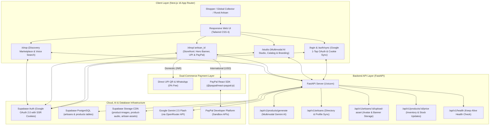

# Vernacular AI — Global Artisan Storefront

[](https://vernacular-storefront.onrender.com)
[](https://nextjs.org/)
[](https://fastapi.tiangolo.com/)
[](https://developer.paypal.com/)
[](https://deepmind.google/technologies/gemini/)
[](https://supabase.com/)
[](https://www.typescriptlang.org/)
[](https://tailwindcss.com/)
[](#)
[](#)

> **Empowering rural Indian weavers with voice-first multimodal AI, localized digital boutiques, 100% zero-commission domestic commerce, and global cross-border export powered by PayPal.**

---

## 💡 The Dual Hackathon Mission

India's traditional handloom sector sustains over **4.3 million weavers and artisans**, producing some of the world's finest hand-loomed textiles (Jamdani, Taant, Baluchari, Khadi, Tussar Silk). Despite their exceptional craftsmanship, over **80% of artisans remain excluded from digital and global commerce** due to:
1. **Linguistic & Literacy Barriers:** Mainstream platforms (Amazon, Etsy, Shopify) require English fluency, complex SKU spreadsheets, and manual text copywriting.
2. **Predatory Middlemen:** Aggregators and regional intermediaries take 30%–50% cuts, keeping rural weavers at subsistence income levels.
3. **Cross-Border Export Friction:** International shoppers crave authentic heritage textiles, but rural artisans cannot manage currency conversion, international merchant accounts, or export cataloging.

### Submission Alignment

| Track | Hackathon Focus | How Our Solution Delivers |
|---|---|---|
| 🇮🇳 **Seva First Innovation Challenge** | Rural Empowerment & Digital Inclusion | **Zero-Typing Studio:** Artisans snap a photo and record a voice description in their native language (Bengali/Hindi). **0% Platform Cut:** 100% direct-to-weaver UPI QR payments and WhatsApp commerce ensure every single rupee goes directly to the weaver. |
| 🌍 **PayPal AI Hackathon** | Next-Gen AI & Global Cross-Border Commerce | **AI Global Pricing Engine:** Gemini 2.5 Flash analyzes weave complexity to generate fair domestic INR prices, premium USD export pricing (`price_usd`), and heritage storytelling (`export_description`). **PayPal React SDK:** International buyers checkout seamlessly with PayPal while artisans receive global funds straight to their linked PayPal account. |

---

## 🌟 Core Feature Suite

### 1. Multimodal Voice & Vision AI Cataloging (`/studio`)
* **Zero-Typing Camera Studio:** Artisans upload photos of their saree or textile and speak naturally in their native dialect.
* **Google Gemini 2.5 Flash Multimodal Engine:** Simultaneously inspects the garment photograph and spoken audio waveform to synthesize:
  * Bilingual titles and descriptions (English + native Bengali/Hindi script).
  * Automated craft classification (weave technique, fabric, regional motif).
  * Fair domestic market valuation range in INR (`suggested_price_range`).
  * International boutique USD valuation (`suggested_usd_price`) and heritage narrative (`export_description`).
* **Supabase Media Storage CDN:** Automated compression and public delivery of product photos, weaver voice recordings, and profile assets.

### 2. Dual-Checkout Storefront UI (`/shop/[artisan_id]`)
* **Shipping Destination Toggle:** Shoppers choose their purchasing context:
  `[ 🇮🇳 Domestic (INR) ]  |  [ 🌍 International (USD) ]`
* **🇮🇳 Domestic Mode:**
  * Displays domestic INR price (`₹1,800`).
  * **Instant UPI Pay Modal (0% Fee):** Generates dynamic, standard Indian banking QR codes (`qrcode.react`) and mobile deep links (`upi://pay?pa=...`) launching GPay, PhonePe, Paytm, or BHIM.
  * **WhatsApp 1-Tap Commerce:** Direct WhatsApp conversation link with pre-filled item details and phone number normalization.
* **🌍 International Export Mode:**
  * Displays international USD price (`$45.00`) and the AI-generated heritage export narrative.
  * Hides domestic payment buttons.
  * Integrates the official `@paypal/react-paypal-js` SDK with lazy script loading (`deferLoading={destination !== "international"}`) for maximum page performance.
  * Captures orders into the artisan's linked `paypal_email` in the PayPal Sandbox environment.
* **Voice of the Weaver Audio Player:** Streams the artisan's original native voice note alongside the AI-translated text, establishing authenticity and emotional connection.
* **Masterpiece Showcase Carousel:** Randomized, infinitely sliding carousel highlighting the breadth of the weaver's portfolio.

### 3. Artisan Profile & Storefront Branding Studio (`/studio`)
* **Dedicated "Profile & Branding" Tab:** New top-level navigation inside Studio allowing weavers to customize their identity without technical friction.
* **Client-Compressed Drag-and-Drop Uploaders:**
  * **Profile Avatar:** Square photo uploader with client canvas compression and a 2MB limit.
  * **Storefront Cover Banner:** 16:9 landscape banner uploader displaying at the top of their public storefront and marketplace cards.
  * **Service-Role Asset Pipeline:** Backed by `POST /api/v1/artisans/{artisan_id}/upload-asset` with automatic direct Supabase Storage (`artisan-assets` bucket) fallback.
* **Optimistic Directory Card Preview:** Live interactive preview card mirroring the public marketplace card that updates instantaneously as the weaver edits their name, avatar, or banner.
* **Slide-Out Profile Drawer:** Slide-out drawer accessible from any page to update WhatsApp contact, domestic UPI ID, international PayPal email, and download high-resolution shop QR codes.

### 4. Reusable Deterministic `<ArtisanAvatar />` Component
* **Dynamic Palette Hashing:** Computes a deterministic integer hash from the artisan's display name to assign one of 12 vibrant Tailwind color gradients (replacing plain black circles).
* **Graceful Remote Fallback:** Renders user-uploaded avatars via `next/image` with circular clipping and smooth error handling fallback to initials.

### 5. Production-Hardened Authentication on Render
* **PKCE OAuth Code Exchange:** Route Handler (`src/app/auth/callback/route.ts`) exchanges authorization codes using Supabase SSR client and explicitly binds all session cookies to outgoing `NextResponse.redirect` headers.
* **Reverse-Proxy HTTPS Origin Resolution:** Dynamically inspects `x-forwarded-host`, `host`, and `x-forwarded-proto` to prevent cookie dropping or protocol mismatches on Render.
* **Multi-Tier Reactivity:** `ArtisanContext` and `ShopDirectoryClient` employ active `supabase.auth.onAuthStateChange` listeners with optimistic `user_metadata` population, eliminating "logged out" UI flashes.
* **Clean Top-Level Navigation:** `window.location.replace()` in `/auth/sync` bypasses stale client-side router caches after login.

### 6. Discovery Marketplace & Vernacular Voice Search (`/shop`)
* **Live Native Voice Search:** Spoken search in Bengali, Hindi, or English using the Web Speech API with an animated sound-wave indicator.
* **Regional Craft Filter Pills:** 1-tap filtering across traditional craft styles (Jamdani, Taant, Baluchari, Khadi, Silk).
* **Dynamic Visual Banners:** Artisan cards prioritize custom `banner_url` cover photos with automatic fallback to their latest creation photo.
* **Live Storefront Data:** Route segment configs (`revalidate = 0`, `dynamic = "force-dynamic"`) prevent stale cached data across deployments.

---

## 🏗️ System Architecture



---

## 📁 Repository Structure

```
.
├── backend/
│   ├── app/
│   │   ├── api/
│   │   │   ├── artisans.py          # Artisan registration, directory retrieval & asset uploads
│   │   │   └── products.py          # Multimodal batch generation & inventory pricing endpoints
│   │   ├── core/
│   │   │   ├── config.py            # Pydantic BaseSettings environment loader
│   │   │   └── supabase_client.py   # Service-role Supabase client
│   │   ├── schemas/
│   │   │   └── product.py           # Pydantic models with USD price & export description
│   │   └── services/
│   │       ├── ai_service.py        # Gemini 2.5 Flash prompt for dual-pricing & export narrative
│   │       └── storage_service.py   # Supabase Storage asset uploader & DB persister
│   ├── main.py                      # FastAPI entrypoint with regex CORS middleware
│   ├── schema.sql                   # Database schema definitions & bucket RLS policies
│   ├── auth_trigger.sql             # PostgreSQL trigger syncing auth.users to public.artisans
│   ├── requirements.txt             # Pinned backend dependencies
│   ├── .env.example                 # Environment template for backend
│   └── .gitignore                   # Backend-specific ignore rules
│
├── frontend/
│   ├── public/
│   │   ├── icons/                   # Valid 192x192 & 512x512 PWA icons
│   │   └── manifest.json            # PWA manifest
│   ├── src/
│   │   ├── app/
│   │   │   ├── auth/
│   │   │   │   ├── callback/route.ts# SSR OAuth code exchange & Set-Cookie handler
│   │   │   │   └── sync/page.tsx    # Resilient OAuth session syncer & role router
│   │   │   ├── login/page.tsx       # Dynamic redirectTo Google 1-Tap sign-in interface
│   │   │   ├── shop/
│   │   │   │   ├── page.tsx         # Discovery Marketplace (force-dynamic, revalidate=0)
│   │   │   │   └── [artisan_id]/    # Storefront (Hero Banner, Voice Audio & PayPal SDK)
│   │   │   ├── studio/page.tsx      # Multimodal AI studio, Catalog & Branding Studio
│   │   │   ├── ShopDirectoryClient  # Client component for voice search & category filters
│   │   │   ├── layout.tsx           # Root layout with fonts & context providers
│   │   │   └── page.tsx             # Root route (redirects to /shop)
│   │   ├── components/
│   │   │   ├── ArtisanAvatar.tsx    # Deterministic hashed gradient avatar component
│   │   │   ├── Marquee.tsx          # Animated direct-to-weaver announcement ticker
│   │   │   ├── ProfileDrawer.tsx    # Slide-out drawer for branding, UPI, PayPal & QR
│   │   │   └── LanguageToggle.tsx   # Floating multi-lingual switcher (EN/HI/BN)
│   │   ├── context/
│   │   │   ├── ArtisanContext.tsx   # Global session, role, avatar, banner & profile state
│   │   │   └── LanguageContext.tsx  # Multi-language dictionary provider
│   │   ├── i18n/
│   │   │   └── dictionaries.ts      # English, Hindi, and Bengali localization strings
│   │   ├── lib/
│   │   │   ├── api.ts               # Strongly-typed TypeScript interfaces
│   │   │   └── uploadAsset.ts       # Canvas client compression & asset upload pipeline
│   │   └── utils/
│   │       └── supabase/            # Client, Server, and Middleware Supabase SSR SDKs
│   ├── next.config.mjs              # Next.js config with Supabase & Google image domains
│   ├── package.json                 # Dependencies (Next 16, @paypal/react-paypal-js, Tailwind 4)
│   ├── .env.example                 # Environment template for frontend
│   └── .gitignore                   # Frontend-specific ignore rules
│
├── .gitignore                       # Master root gitignore
└── README.md                        # Master project documentation
```

---

## 🛠️ Step-by-Step Setup Guide

### Prerequisites
* **Node.js** (v18.18+ or v20+)
* **Python** (3.10+)
* **Supabase** account with an active project
* **PayPal Developer** account (for Sandbox Client ID)

---

### 1. Database & Supabase Configuration

1. In your Supabase project's **SQL Editor**, execute [`backend/schema.sql`](file:///C:/Users/IamTeddy/OneDrive/Desktop/IamGenius/Seva%20Innovation%20Challenge%20Project/Vernacular%20AI%20E-Commerce%20Enabler/backend/schema.sql):
   ```sql
   -- Provisions artisans and products tables with columns:
   -- upi_id, whatsapp_number, paypal_email, avatar_url, banner_url,
   -- price_usd, suggested_usd_price, export_description
   ```
2. Execute [`backend/auth_trigger.sql`](file:///C:/Users/IamTeddy/OneDrive/Desktop/IamGenius/Seva%20Innovation%20Challenge%20Project/Vernacular%20AI%20E-Commerce%20Enabler/backend/auth_trigger.sql) to auto-provision profile rows on sign-up with Google avatar sync.
3. In **Storage**, ensure the following public buckets are created with public read access enabled:
   * `product-images` (garment photographs)
   * `product-audio` (spoken voice notes)
   * `artisan-assets` (custom profile avatars and cover banners)
4. In **Authentication > Providers > Google**, enable Google OAuth and configure redirect URLs:
   * `http://localhost:3000/auth/callback` (Local development)
   * `https://vernacular-storefront.onrender.com/auth/callback` (Production)

---

### 2. Backend Setup (FastAPI)

```bash
cd backend

# Create virtual environment
python -m venv venv

# Activate virtual environment
# Windows (PowerShell):
.\venv\Scripts\activate
# macOS/Linux:
source venv/bin/activate

# Install dependencies
pip install -r requirements.txt
```

Create `backend/.env` (referencing [`backend/.env.example`](file:///C:/Users/IamTeddy/OneDrive/Desktop/IamGenius/Seva%20Innovation%20Challenge%20Project/Vernacular%20AI%20E-Commerce%20Enabler/backend/.env.example)):
```env
OPENROUTER_API_KEY=sk-or-v1-your-openrouter-key-here
SUPABASE_URL=https://your-project.supabase.co
SUPABASE_SERVICE_ROLE_KEY=your-supabase-service-role-key-here
SUPABASE_BUCKET=product-images
```

Start the backend server:
```bash
uvicorn main:app --reload --port 8000
```
* Interactive API Documentation: `http://127.0.0.1:8000/docs`
* Health Check: `http://127.0.0.1:8000/api/v1/health`

---

### 3. Frontend Setup (Next.js 16)

```bash
cd frontend

# Install dependencies
npm install
```

Create `frontend/.env.local` (referencing [`frontend/.env.example`](file:///C:/Users/IamTeddy/OneDrive/Desktop/IamGenius/Seva%20Innovation%20Challenge%20Project/Vernacular%20AI%20E-Commerce%20Enabler/frontend/.env.example)):
```env
NEXT_PUBLIC_SUPABASE_URL=https://your-project.supabase.co
NEXT_PUBLIC_SUPABASE_ANON_KEY=your-supabase-anon-key-here
NEXT_PUBLIC_API_URL=http://127.0.0.1:8000
NEXT_PUBLIC_PAYPAL_CLIENT_ID=test
```

Start the frontend development server:
```bash
npm run dev
```
Open [http://localhost:3000](http://localhost:3000) in your browser.

---

### 4. Production Build & Lint Verification

Run the verification suite:
```bash
cd frontend
npm run lint
npm run build
```

Expected output:
```
✓ Compiled successfully
  Running TypeScript ...
  Finished TypeScript in ~2.7s
✓ Generating static pages using 11 workers (8/8)
Finalizing page optimization ...

Route (app)
┌ ○ /
├ ○ /_not-found
├ ƒ /auth/callback
├ ○ /auth/sync
├ ○ /login
├ ƒ /shop
├ ƒ /shop/[artisan_id]
└ ○ /studio
```

---

## 🚀 Live Cloud Deployment (Render)

Both frontend and backend are live on [Render](https://render.com/):

| Service | Type | Live URL / Endpoint |
|---|---|---|
| **Public Storefront** | Next.js 16 (Node.js Web Service) | **`https://vernacular-storefront.onrender.com`** |
| **AI Catalog Engine** | FastAPI / Python (Web Service) | **`https://vernacular-storefront.onrender.com/api`** (or backend URL) |

### Environment Variables Matrix

| Variable | Scope | Purpose |
|---|---|---|
| `NEXT_PUBLIC_SUPABASE_URL` | Frontend & Backend | Supabase project API gateway |
| `NEXT_PUBLIC_SUPABASE_ANON_KEY` | Frontend | Restricted anonymous key for client queries |
| `SUPABASE_SERVICE_ROLE_KEY` | Backend | High-privilege key for storage uploads and profile sync |
| `NEXT_PUBLIC_API_URL` | Frontend | Target URL for backend FastAPI service |
| `NEXT_PUBLIC_PAYPAL_CLIENT_ID` | Frontend | PayPal Developer Sandbox / Live client identifier |
| `OPENROUTER_API_KEY` | Backend | Multimodal access token for Google Gemini 2.5 Flash |

---

## 🔒 Security & Git Hygiene Standards

* **Zero Hardcoded Credentials:** Supabase keys, Gemini/OpenRouter keys, and PayPal credentials are exclusively read from runtime environment variables.
* **Strict Git Hygiene:** All `.env`, `.env.local`, `.venv/`, `node_modules/`, and `.next/` directories are strictly excluded via `.gitignore`.
* **CORS Whitelist:** FastAPI backend allows local development (`localhost:3000`) and dynamically matches production domains.
* **Cookie Security & SSR Integrity:** Enforces `SameSite=Lax`, `Path=/`, and `Secure=true` on HTTPS domains, ensuring cookies are preserved across reverse proxies.
* **Service-Role Boundary:** Public clients interact using restricted anonymous tokens. High-privilege writes (such as automated profile provisioning and AI catalog insertions) execute server-side using the `SUPABASE_SERVICE_KEY`.

---

## 📊 Impact Matrix

| Dimension | Traditional Global E-Commerce (Etsy, Amazon) | Vernacular AI Enabler (Global Export Mode) |
|---|---|---|
| **Artisan Onboarding** | Days (tax IDs, English portals, SKU forms) | **< 60 seconds** (voice note + camera snap) |
| **Cataloging & Pricing** | Manual copywriting & currency conversion | **Automated Dual-Pricing** by Gemini 2.5 Flash (INR + USD) |
| **Profile & Store Branding** | Complex web builders & manual image tools | **In-App Drag-and-Drop Studio** with live card preview & compression |
| **Platform Commission** | 20% to 45% (middlemen, fees, listing costs) | **0% Platform Fee** (100% direct to artisan) |
| **Domestic Payments** | Delayed bank transfers (7–14 days) | **Instant Direct UPI QR** (0% transaction fee) |
| **Global Export Payments** | High barrier, unavailable for rural weavers | **Seamless PayPal React SDK** with sandbox USD payments |
| **Linguistic Inclusion** | English only | **Trilingual Voice & UI** (Bengali, Hindi, English) |
| **Cultural Provenance** | Generic mass-manufactured textile description | **Authentic Heritage Story** with audio snippet player |

---

## 📄 License & Attribution

Developed for the **Seva First Innovation Challenge** and the **PayPal AI Hackathon**. Dedicated to preserving and celebrating India's rich artisanal heritage on the global stage.
