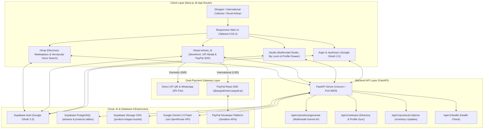

# Vernacular AI E-Commerce Enabler (Global Export Edition)

[](https://nextjs.org/)
[](https://fastapi.tiangolo.com/)
[](https://developer.paypal.com/)
[](https://deepmind.google/technologies/gemini/)
[](https://supabase.com/)
[](https://www.typescriptlang.org/)
[](https://tailwindcss.com/)
[](#)
[](#)

> **Empowering rural Indian weavers with voice-first multimodal AI, localized digital boutiques, 100% zero-commission domestic commerce, and global cross-border export powered by PayPal.**

---

## 💡 The Dual Hackathon Mission

India's traditional handloom sector sustains over **4.3 million weavers and artisans**, producing some of the world's finest hand-loomed textiles (Jamdani, Taant, Baluchari, Khadi, Tussar Silk). Despite their exceptional craftsmanship, over **80% of artisans remain excluded from digital and global commerce** due to:
1. **Linguistic & Literacy Barriers:** Mainstream platforms (Amazon, Etsy, Shopify) require English fluency, complex SKU spreadsheets, and manual text copywriting.
2. **Predatory Middlemen:** Aggregators and regional intermediaries take 30%–50% cuts, keeping rural weavers at subsistence income levels.
3. **Cross-Border Export Friction:** International shoppers crave authentic heritage textiles, but rural artisans cannot manage currency conversion, international merchant accounts, or export cataloging.

### Submission Alignment

| Track | Hackathon Focus | How Our Solution Delivers |
|---|---|---|
| 🇮🇳 **Seva First Innovation Challenge** | Rural Empowerment & Digital Inclusion | **Zero-Typing Studio:** Artisans snap a photo and record a voice description in their native language (Bengali/Hindi). **0% Platform Cut:** 100% direct-to-weaver UPI QR payments and WhatsApp commerce ensure every rupee goes directly to the weaver. |
| 🌍 **PayPal AI Hackathon** | Next-Gen AI & Global Cross-Border Commerce | **AI Global Pricing Engine:** Gemini 2.5 Flash analyzes weave complexity to generate fair domestic INR prices, premium USD export pricing (`price_usd`), and heritage storytelling (`export_description`). **PayPal React SDK:** International buyers checkout seamlessly with PayPal while artisans receive global funds straight to their linked PayPal account. |

---

## 🌟 Core Feature Suite

### 1. Multimodal Voice & Vision AI Cataloging (`/studio`)
* **Zero-Typing Camera Studio:** Artisans upload photos of their saree or textile and speak naturally in their dialect.
* **Google Gemini 2.5 Flash Multimodal Engine:** Simultaneously inspects the garment photograph and spoken audio waveform to synthesize:
  * Bilingual titles and descriptions (English + native Bengali/Hindi script).
  * Automated craft classification (weave technique, fabric, regional motif).
  * Fair domestic market valuation range in INR (`suggested_price_range`).
  * International boutique USD valuation (`suggested_usd_price`) and heritage narrative (`export_description`).
* **Supabase Media Storage CDN:** Automated compression and public delivery of product photos and weaver voice recordings.

### 2. Dual-Checkout Storefront UI (`/shop/[artisan_id]`)
* **Shipping Destination Toggle:** Shoppers choose their purchasing context:
  `[ 🇮🇳 Domestic (INR) ]  |  [ 🌍 International (USD) ]`
* **🇮🇳 Domestic Mode:**
  * Displays domestic INR price (`₹1,800`).
  * **Instant UPI Pay Modal (0% Fee):** Generates dynamic, standard Indian banking QR codes (`qrcode.react`) and mobile deep links (`upi://pay?pa=...`) launching GPay, PhonePe, Paytm, or BHIM.
  * **WhatsApp 1-Tap Commerce:** Direct WhatsApp conversation link with pre-filled item details and phone number normalization.
* **🌍 International Export Mode:**
  * Displays international USD price (`$45.00`) and the AI-generated heritage export narrative.
  * Hides domestic payment buttons.
  * Integrates the official `@paypal/react-paypal-js` SDK with lazy script loading (`deferLoading={destination !== "international"}`) for maximum page performance.
  * Captures orders into the artisan's linked `paypal_email` in the PayPal Sandbox environment.

### 3. Unified Authentication & Smart Role Routing (`/login`, `/auth/sync`)
* **Google 1-Tap OAuth:** Instant authentication via Supabase Auth with automatic account selection (`prompt: 'select_account'`).
* **Role Switcher:** Onboarding allows choosing between **"I want to shop"** (`customer`) and **"I am an artisan"** (`artisan`).
* **Resilient Sync Engine (`/auth/sync`):** Handles PKCE authorization codes, automatic session exchange, and PostgreSQL profile upserts with service-role failover.
* **Smart Intent Routing:** Customers route to Discovery (`/shop`), while artisans route to their Studio (`/studio`).

### 4. "My Loom" Inventory & Profile Management (`/studio`)
* **Live Product Management:** View all published creations with real-time stock toggles.
* **Custom Tailwind Delete Confirmation:** Clean modal replaces intrusive browser alert boxes.
* **Reactive Cache Purging:** Mutations trigger Next.js `router.refresh()` to instantly reflect changes on the storefront.
* **Unified Profile Drawer:** Configure display name, WhatsApp business phone, domestic UPI ID, and international PayPal email.

### 5. Discovery Marketplace & Vernacular Voice Search (`/shop`)
* **Live Voice Search:** Spoken search in Bengali, Hindi, or English using the Web Speech API with an animated sound-wave indicator.
* **Regional Craft Filter Pills:** 1-tap filtering across traditional crafts (Jamdani, Taant, Baluchari, Khadi, Silk).
* **Live Storefront Data:** Route segment configs (`revalidate = 0`, `dynamic = "force-dynamic"`) prevent stale cached data.

---

## 🏗 System Architecture



---

## 📁 Repository Structure

```
.
├── backend/
│   ├── app/
│   │   ├── api/
│   │   │   ├── artisans.py          # Artisan registration, directory retrieval & profile updates
│   │   │   └── products.py          # Multimodal batch generation & inventory pricing endpoints
│   │   ├── core/
│   │   │   ├── config.py            # Pydantic BaseSettings environment loader
│   │   │   └── supabase_client.py   # Service-role Supabase client
│   │   ├── schemas/
│   │   │   └── product.py           # Pydantic models with USD price & export description
│   │   └── services/
│   │       ├── ai_service.py        # Gemini 2.5 Flash prompt for dual-pricing & export narrative
│   │       └── storage_service.py   # Supabase Storage asset uploader & DB persister
│   ├── main.py                      # FastAPI entrypoint with regex CORS middleware
│   ├── schema.sql                   # Database schema definitions & ALTER TABLE migrations
│   ├── auth_trigger.sql             # PostgreSQL trigger syncing auth.users to public.artisans
│   ├── requirements.txt             # Pinned backend dependencies
│   ├── .env.example                 # Environment template for backend
│   └── .gitignore                   # Backend-specific ignore rules
│
├── frontend/
│   ├── public/
│   │   ├── icons/                   # Valid 192x192 & 512x512 PWA icons
│   │   └── manifest.json            # PWA manifest
│   ├── src/
│   │   ├── app/
│   │   │   ├── auth/
│   │   │   │   ├── callback/route.ts# Next.js OAuth code exchange handler
│   │   │   │   └── sync/page.tsx    # Resilient OAuth session syncer & role router
│   │   │   ├── login/page.tsx       # Dual-role Google 1-Tap sign-in interface
│   │   │   ├── shop/
│   │   │   │   ├── page.tsx         # Discovery Marketplace (force-dynamic, revalidate=0)
│   │   │   │   └── [artisan_id]/    # Dual-Checkout Storefront (UPI QR + PayPal SDK)
│   │   │   ├── studio/page.tsx      # Multimodal AI studio & "My Loom" catalog manager
│   │   │   ├── ShopDirectoryClient  # Client component for voice search & category filters
│   │   │   ├── layout.tsx           # Root layout with fonts & context providers
│   │   │   └── page.tsx             # Root route (redirects to /shop)
│   │   ├── components/
│   │   │   ├── Marquee.tsx          # Animated direct-to-weaver announcement ticker
│   │   │   ├── ProfileDrawer.tsx    # Slide-out drawer for UPI, PayPal email, and phone
│   │   │   └── LanguageToggle.tsx   # Floating multi-lingual switcher (EN/HI/BN)
│   │   ├── context/
│   │   │   ├── ArtisanContext.tsx   # Global session, role & profile state
│   │   │   └── LanguageContext.tsx  # Multi-language dictionary provider
│   │   ├── i18n/
│   │   │   └── dictionaries.ts      # English, Hindi, and Bengali localization strings
│   │   ├── lib/
│   │   │   └── api.ts               # Strongly-typed TypeScript interfaces
│   │   └── utils/
│   │       └── supabase/            # Client, Server, and Middleware Supabase SDKs
│   ├── next.config.mjs              # Next.js config with Supabase image domains & API proxy
│   ├── package.json                 # Dependencies (Next 16, @paypal/react-paypal-js, Tailwind)
│   ├── .env.example                 # Environment template for frontend
│   └── .gitignore                   # Frontend-specific ignore rules
│
├── .gitignore                       # Master root gitignore
└── README.md                        # Master project documentation
```

---

## 🛠️ Step-by-Step Setup Guide

### Prerequisites
* **Node.js** (v18.18+ or v20+)
* **Python** (3.10+)
* **Supabase** account with an active project
* **PayPal Developer** account (for Sandbox Client ID)

---

### 1. Database & Supabase Configuration

1. In your Supabase project's **SQL Editor**, run [`backend/schema.sql`](file:///C:/Users/IamTeddy/OneDrive/Desktop/IamGenius/Seva%20Innovation%20Challenge%20Project/Vernacular%20AI%20E-Commerce%20Enabler/backend/schema.sql):
   ```sql
   -- Provisions artisans and products tables with columns:
   -- upi_id, whatsapp_number, paypal_email, price_usd, suggested_usd_price, export_description
   ```
2. Run [`backend/auth_trigger.sql`](file:///C:/Users/IamTeddy/OneDrive/Desktop/IamGenius/Seva%20Innovation%20Challenge%20Project/Vernacular%20AI%20E-Commerce%20Enabler/backend/auth_trigger.sql) to provision profiles on sign-up.
3. In **Storage**, create a public bucket named `product-images` with public read access enabled.
4. In **Authentication > Providers > Google**, enable Google OAuth and configure redirect URLs:
   * `http://localhost:3000/auth/callback` (Local dev)
   * `https://your-domain.vercel.app/auth/callback` (Production)

---

### 2. Backend Setup (FastAPI)

```bash
cd backend

# Create virtual environment
python -m venv venv

# Activate virtual environment
# Windows:
.\venv\Scripts\activate
# macOS/Linux:
source venv/bin/activate

# Install dependencies
pip install -r requirements.txt
```

Create `backend/.env` (referencing [`backend/.env.example`](file:///C:/Users/IamTeddy/OneDrive/Desktop/IamGenius/Seva%20Innovation%20Challenge%20Project/Vernacular%20AI%20E-Commerce%20Enabler/backend/.env.example)):
```env
OPENROUTER_API_KEY=sk-or-v1-your-openrouter-key-here
SUPABASE_URL=https://your-project.supabase.co
SUPABASE_SERVICE_ROLE_KEY=your-supabase-service-role-key-here
SUPABASE_BUCKET=product-images
```

Start the backend server:
```bash
uvicorn main:app --reload --port 8000
```
* Interactive API Documentation: `http://127.0.0.1:8000/docs`
* Health Check: `http://127.0.0.1:8000/api/v1/health`

---

### 3. Frontend Setup (Next.js 16)

```bash
cd frontend

# Install dependencies
npm install
```

Create `frontend/.env.local` (referencing [`frontend/.env.example`](file:///C:/Users/IamTeddy/OneDrive/Desktop/IamGenius/Seva%20Innovation%20Challenge%20Project/Vernacular%20AI%20E-Commerce%20Enabler/frontend/.env.example)):
```env
NEXT_PUBLIC_SUPABASE_URL=https://your-project.supabase.co
NEXT_PUBLIC_SUPABASE_ANON_KEY=your-supabase-anon-key-here
NEXT_PUBLIC_API_URL=http://127.0.0.1:8000
NEXT_PUBLIC_PAYPAL_CLIENT_ID=test
```

Start the frontend server:
```bash
npm run dev
```
Open [http://localhost:3000](http://localhost:3000) in your browser.

---

### 4. Production Build & Lint Verification

Run the production verification suite:
```bash
cd frontend
npm run lint
npm run build
```

Expected result:
```
✓ Compiled successfully
  Running TypeScript ...
  Finished TypeScript in ~2s
✓ Generating static pages (8/8)
Finalizing page optimization ...

Route (app)
┌ ○ /
├ ○ /_not-found
├ ƒ /auth/callback
├ ○ /auth/sync
├ ○ /login
├ ƒ /shop
├ ƒ /shop/[artisan_id]
└ ○ /studio
```

---

## 🚀 Cloud Deployment Guide

### Deploy Frontend (Vercel)
1. Push your repository to GitHub.
2. Import the `frontend` directory as the project root on [Vercel](https://vercel.com/).
3. Configure Environment Variables in Vercel:
   * `NEXT_PUBLIC_SUPABASE_URL`: Your Supabase URL
   * `NEXT_PUBLIC_SUPABASE_ANON_KEY`: Your Supabase Anon Key
   * `NEXT_PUBLIC_API_URL`: Your deployed FastAPI backend URL
   * `NEXT_PUBLIC_PAYPAL_CLIENT_ID`: Your PayPal Developer Client ID
4. Deploy!

### Deploy Backend (Render)
1. In [Render](https://render.com/), create a new **Web Service** pointing to the `backend` directory.
2. Build Command: `pip install -r requirements.txt`
3. Start Command: `uvicorn main:app --host 0.0.0.0 --port $PORT`
4. Configure Environment Variables in Render:
   * `OPENROUTER_API_KEY`: OpenRouter API Key
   * `SUPABASE_URL`: Supabase Project URL
   * `SUPABASE_SERVICE_ROLE_KEY`: Supabase Service Role Key
   * `SUPABASE_BUCKET`: `product-images`
5. Deploy!

---

## 🔒 Security & Git Hygiene Standards

* **Zero Hardcoded Credentials:** Supabase keys, Gemini/OpenRouter keys, and PayPal credentials are exclusively read from runtime environment variables.
* **Strict Git Hygiene:** All `.env`, `.env.local`, `.venv/`, `node_modules/`, and `.next/` directories are strictly excluded via `.gitignore`.
* **Zero Dead Code:** Debugging `console.log()` statements removed; unused imports and obsolete OTP references fully pruned.
* **CORS Whitelist:** FastAPI backend allows local development (`localhost:3000`) and dynamically matches all production Vercel domains (`r"https://.*\.vercel\.app"`).
* **Defensive Error Handling:** All async operations, Supabase fetches, and state changes implement robust `try/catch/finally` blocks to guarantee no stuck loading spinners.

---

## 📊 Impact Matrix

| Dimension | Traditional Global E-Commerce (Etsy, Amazon) | Vernacular AI Enabler (Global Export Mode) |
|---|---|---|
| **Artisan Onboarding** | Days (tax IDs, English portals, SKU forms) | **< 60 seconds** (voice note + camera snap) |
| **Cataloging & Pricing** | Manual copywriting & currency conversion | **Automated Dual-Pricing** by Gemini 2.5 Flash (INR + USD) |
| **Platform Commission** | 20% to 45% (middlemen, fees, listing costs) | **0% Platform Fee** (100% direct to artisan) |
| **Domestic Payments** | Delayed bank transfers (7–14 days) | **Instant Direct UPI QR** (0% transaction fee) |
| **Global Export Payments** | High barrier, unavailable for rural weavers | **Seamless PayPal React SDK** with sandbox USD payments |
| **Linguistic Inclusion** | English only | **Trilingual Voice & UI** (Bengali, Hindi, English) |
| **Cultural Provenance** | Generic mass-manufactured textile description | **Authentic Heritage Story** with audio snippet player |

---

## 📄 License & Attribution

Developed for the **Seva First Innovation Challenge** and the **PayPal AI Hackathon**. Dedicated to bringing India's timeless handloom heritage to the global stage.
