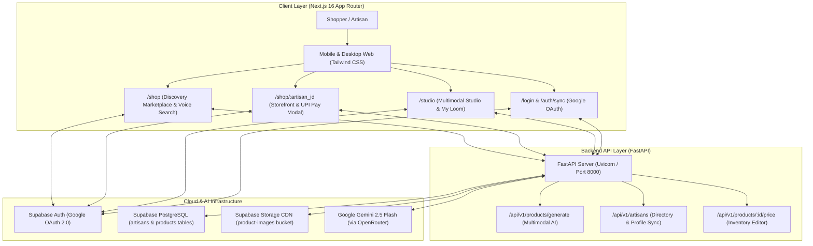

# Vernacular AI E-Commerce Enabler

[](https://nextjs.org/)
[](https://fastapi.tiangolo.com/)
[](https://supabase.com/)
[](https://deepmind.google/technologies/gemini/)
[](https://www.typescriptlang.org/)
[](https://tailwindcss.com/)
[](#)

> **Empowering rural Indian weavers with voice-first multimodal AI, localized digital boutiques, and 100% zero-commission direct-to-weaver commerce.**

---

## 💡 Problem Statement & Vision

India's traditional handloom sector sustains over **4.3 million weavers and artisans**, producing some of the world's finest textiles (Jamdani, Taant, Baluchari, Khadi, Tussar Silk). Yet, over **80% of artisans remain excluded from digital commerce** due to:
1. **Linguistic & Literacy Barriers:** Existing e-commerce dashboards (Amazon, Shopify, Flipkart) require English literacy, complex SKU configuration, and text cataloging.
2. **Predatory Middlemen:** Intermediary aggregators take 30–50% margins, depriving weavers of fair market compensation.
3. **Impersonal Catalogs:** Mass-market listings strip away the oral heritage, cultural provenance, and human story behind each weave.

**Vernacular AI E-Commerce Enabler** eliminates these barriers. Using **multimodal AI (Google Gemini 2.5 Flash)** and **voice-first vernacular interfaces**, an artisan can snap photos of their textile, speak naturally in their native tongue (Bengali, Hindi, or English), and instantly generate an editorial digital boutique complete with bilingual descriptions, fair-market valuation, scannable QR storefronts, and direct UPI / WhatsApp zero-commission checkout.

---

## 🌟 Core Pillars & Feature Suite

### 1. Multimodal Voice & Vision AI Cataloging (`/studio`)
* **Zero-Typing Studio:** Artisans upload up to 8 photos and record a voice description in their dialect.
* **Gemini 2.5 Flash Engine:** Concurrently processes audio waveform and high-resolution garment imagery to synthesize:
  * Bilingual titles and descriptions (English + localized script: Bengali/Hindi).
  * Automated craft classification (weave type, fabric composition, motif provenance).
  * Fair-market price estimation range (INR) based on detected complexity and technique.
  * Extracted selling price and contextual catalog tags.
* **Supabase Media Storage CDN:** Automatically stores product imagery and weaver audio snippets for public streaming.

### 2. Dual-Role Unified Authentication & Intent Routing (`/login`, `/auth/sync`)
* **Google 1-Tap OAuth:** Single-tap secure authentication powered by Supabase Auth with automatic account selection (`prompt: 'select_account'`).
* **Interactive Role Switcher:** Onboarding allows choosing between **"I want to shop"** (`customer`) and **"I am an artisan"** (`artisan`).
* **Resilient Sync Engine (`/auth/sync`):** Handles PKCE authorization codes, automatic session exchange, and PostgreSQL profile upserts with backend service-role failover.
* **Smart Intent Routing:**
  * Customers are routed directly to the **Discovery Marketplace** (`/shop`).
  * Artisans are routed directly to their **AI Creation Studio** (`/studio`).

### 3. Zero-Commission "Direct-to-Weaver" Commerce (`/shop/[artisan_id]`)
* **100% Direct Payouts:** Zero platform cut, zero listing fees, zero middleman arbitrage.
* **Instant UPI Pay Modal (0% Fee):**
  * Dynamic vector QR code generation (via `qrcode.react`) formatted with standard Indian banking URI specifications:
    ```
    upi://pay?pa={upi_id}&pn={artisan_name}&am={price}&cu=INR&tn={product_title}
    ```
  * Mobile deep-link button (`<a href={upiUri}>`) that directly launches GPay, PhonePe, Paytm, or BHIM on mobile devices.
* **1-Tap WhatsApp Commerce Loop:**
  * One-click checkout button opening a pre-filled WhatsApp conversation with the weaver.
  * Auto-sanitizes phone numbers with country code normalization (`+91`).
  * Pre-fills item title, price, and exact storefront URL for seamless fulfillment.

### 4. Discovery Marketplace & Vernacular Voice Search (`/shop`)
* **Customer Filtering & Parallel Fetch:** Excludes customer accounts from the artisan directory using parallel PostgREST queries for zero schema friction.
* **Dynamic Artisan Covers & Creation Counters:** Dynamically showcases the artisan's latest uploaded masterpiece as the card banner alongside a live creation count badge.
* **Web Speech API Voice Search:** Real-time spoken search in Bengali, Hindi, or English with an animated listening indicator.
* **Regional Craft Filter Pills:** Instant 1-tap filtering across heritage craft categories (All, Jamdani, Taant, Baluchari, Khadi, Silk).

### 5. "My Loom" Artisan Inventory Management (`/studio`)
* **Interactive Inventory Grid:** Live overview of all products published by the artisan.
* **Inline Price Editor:** Tap to adjust listing prices in real-time with instant backend persistence.
* **In-Stock Availability Toggle:** 1-click toggle to mark items in-stock or sold-out.
* **Direct Deletion:** Safe product removal with immediate UI feedback and database synchronization.

### 6. Profile Commerce Settings
* **Unified Profile Drawer:** Configurable from the Studio navigation bar.
* **WhatsApp Order Line (`whatsapp_number`):** Dedicated phone binding for customer WhatsApp orders.
* **UPI Payout ID (`upi_id`):** Custom VPA configuration (`artisan@okaxis`, `weaver@upi`) powering the instant QR checkout modal.

---

## 🏗 System Architecture



---

## 📁 Repository Structure

```
.
├── backend/
│   ├── app/
│   │   ├── api/
│   │   │   ├── artisans.py          # Artisan listing, retrieval, registration & PATCH
│   │   │   └── products.py          # Multimodal batch generation & price update API
│   │   ├── core/
│   │   │   ├── config.py            # Pydantic BaseSettings environment loader
│   │   │   └── supabase_client.py   # Initialized Supabase service-role client
│   │   ├── schemas/
│   │   │   └── product.py           # Pydantic models for product & batch responses
│   │   └── services/
│   │       ├── ai_service.py        # Gemini 2.5 Flash multimodal vision & voice parser
│   │       └── storage_service.py   # Supabase Storage asset uploader & DB persister
│   ├── main.py                      # FastAPI app entrypoint with regex CORS middleware
│   ├── auth_trigger.sql             # PostgreSQL trigger syncing auth.users to public.artisans
│   ├── schema.sql                   # Database schema definitions
│   ├── requirements.txt             # Pinned backend dependencies
│   ├── .env.example                 # Environment template for backend
│   └── .gitignore                   # Backend-specific ignore rules
│
├── frontend/
│   ├── public/
│   │   ├── icons/                   # Valid 192x192 & 512x512 PWA icons
│   │   └── manifest.json            # PWA manifest with any-maskable icons
│   ├── src/
│   │   ├── app/
│   │   │   ├── auth/
│   │   │   │   ├── callback/route.ts# Next.js OAuth code exchange handler
│   │   │   │   └── sync/page.tsx    # Resilient OAuth session syncer & role router
│   │   │   ├── login/page.tsx       # Dual-role Google 1-Tap sign-in interface
│   │   │   ├── shop/
│   │   │   │   ├── page.tsx         # Discovery Marketplace SSR entrypoint (force-dynamic)
│   │   │   │   └── [artisan_id]/    # Dynamic artisan boutique storefront (force-dynamic)
│   │   │   ├── studio/page.tsx      # Artisan camera studio & "My Loom" inventory
│   │   │   ├── ShopDirectoryClient  # Client component for voice search & category filters
│   │   │   ├── layout.tsx           # Root layout with fonts & context providers
│   │   │   └── page.tsx             # Root route (redirects to /shop)
│   │   ├── components/
│   │   │   └── LanguageToggle.tsx   # Floating multi-lingual switcher (EN/HI/BN)
│   │   ├── context/
│   │   │   ├── ArtisanContext.tsx   # Global session, role & profile state
│   │   │   └── LanguageContext.tsx  # Multi-language dictionary provider
│   │   ├── i18n/
│   │   │   └── dictionaries.ts      # Full English, Hindi, and Bengali localization strings
│   │   ├── lib/
│   │   │   └── api.ts               # Strongly-typed client interfaces (Artisan, Product)
│   │   └── utils/
│   │       └── supabase/            # Client, Server, and Middleware Supabase SDKs
│   ├── next.config.mjs              # Next.js config with Supabase image domains & API proxy
│   ├── package.json                 # Frontend dependencies (Next 16, Lucide, qrcode.react)
│   ├── .env.example                 # Environment template for frontend
│   └── .gitignore                   # Frontend-specific ignore rules
│
├── .gitignore                       # Root-level gitignore
└── README.md                        # Master project documentation
```

---

## 🛠️ Step-by-Step Setup Guide

### Prerequisites
* **Node.js** (v18.18+ or v20+)
* **Python** (3.10+)
* **Supabase** account with an active project

---

### 1. Database & Supabase Configuration

1. In your Supabase project's **SQL Editor**, run [`backend/schema.sql`](file:///C:/Users/IamTeddy/OneDrive/Desktop/IamGenius/Seva%20Innovation%20Challenge%20Project/Vernacular%20AI%20E-Commerce%20Enabler/backend/schema.sql):
   ```sql
   -- Creates the artisans and products tables with new commerce fields
   -- (whatsapp_number, upi_id, price, in_stock, suggested_price_range)
   ```
2. Run [`backend/auth_trigger.sql`](file:///C:/Users/IamTeddy/OneDrive/Desktop/IamGenius/Seva%20Innovation%20Challenge%20Project/Vernacular%20AI%20E-Commerce%20Enabler/backend/auth_trigger.sql):
   ```sql
   -- Automatically provisions an artisan profile row upon Google sign-up
   ```
3. In **Storage**, create a public bucket named `product-images` with public read access enabled.
4. In **Authentication > Providers > Google**, enable Google OAuth and configure your Redirect URL:
   * `http://localhost:3000/auth/callback` (for local development)
   * `https://your-domain.vercel.app/auth/callback` (for production)

---

### 2. Backend Setup (FastAPI)

```bash
cd backend

# Create virtual environment
python -m venv venv

# Activate virtual environment
# Windows:
.\venv\Scripts\activate
# macOS/Linux:
source venv/bin/activate

# Install clean dependencies
pip install -r requirements.txt
```

Create `backend/.env` (referencing [`backend/.env.example`](file:///C:/Users/IamTeddy/OneDrive/Desktop/IamGenius/Seva%20Innovation%20Challenge%20Project/Vernacular%20AI%20E-Commerce%20Enabler/backend/.env.example)):
```env
OPENROUTER_API_KEY=sk-or-v1-your-key-here
SUPABASE_URL=https://your-project.supabase.co
SUPABASE_SERVICE_ROLE_KEY=your-supabase-service-role-key-here
SUPABASE_BUCKET=product-images
```

Start the FastAPI backend server:
```bash
uvicorn main:app --reload --port 8000
```
* Interactive API documentation: `http://127.0.0.1:8000/docs`
* Health check: `http://127.0.0.1:8000/api/v1/health`

---

### 3. Frontend Setup (Next.js 16)

```bash
cd frontend

# Install dependencies
npm install
```

Create `frontend/.env.local` (referencing [`frontend/.env.example`](file:///C:/Users/IamTeddy/OneDrive/Desktop/IamGenius/Seva%20Innovation%20Challenge%20Project/Vernacular%20AI%20E-Commerce%20Enabler/frontend/.env.example)):
```env
NEXT_PUBLIC_SUPABASE_URL=https://your-project.supabase.co
NEXT_PUBLIC_SUPABASE_ANON_KEY=your-supabase-anon-key-here
NEXT_PUBLIC_API_URL=http://127.0.0.1:8000
```

Start the frontend development server:
```bash
npm run dev
```
Open [http://localhost:3000](http://localhost:3000) in your browser.

---

### 4. Production Build Verification

Verify that the Next.js production build runs cleanly with zero linting or type errors:

```bash
cd frontend
npm run lint
npm run build
```

Expected output:
```
✓ Compiled successfully in 1886ms
  Running TypeScript ...
  Finished TypeScript in 1971ms ...
✓ Generating static pages using 11 workers (8/8) in 831ms
Finalizing page optimization ...

Route (app)
┌ ○ /
├ ○ /_not-found
├ ƒ /auth/callback
├ ○ /auth/sync
├ ○ /login
├ ƒ /shop
├ ƒ /shop/[artisan_id]
└ ○ /studio
```

---

## 🔒 Security & Deployment Checklist

* **Environment Isolation:** Secrets (`.env`, `.env.local`, API keys) are strictly ignored in `.gitignore` with provided clean templates (`.env.example`).
* **Service Role Guardrail:** The frontend uses the restricted Supabase `ANON_KEY` for public read queries. Sensitive database writes and file storage operations are channeled through the FastAPI backend utilizing the secure `SERVICE_ROLE_KEY`.
* **CORS Security:** Backend CORS permits localhost during development and matches production Vercel domains via regular expressions (`r"https://.*\.vercel\.app"`).
* **PWA & Asset Performance:** Includes validated 192x192 and 512x512 PWA icons with `maskable` compliance and remote image optimization for `*.supabase.co`.

---

## 🏆 Hackathon Impact & Social Value

| Dimension | Traditional E-Commerce | Vernacular AI Enabler |
|---|---|---|
| **Onboarding Time** | Days (Tax forms, SKU spreadsheets, English portals) | **< 60 seconds** (Snap photo, speak voice note) |
| **Cataloging Effort** | Manual copywriting, image cropping, SEO tags | **Fully automated** (Gemini 2.5 Flash multimodal AI) |
| **Platform Commission** | 20% to 45% (Aggregators & market intermediaries) | **0% Platform Fee** (100% direct-to-weaver UPI / WhatsApp) |
| **Linguistic Accessibility** | English-centric interfaces | **Full Vernacular Support** (Hindi, Bengali, English) |
| **Cultural Provenance** | Generic mass-manufactured product listings | **Editorial Storytelling** with "Voice of the Weaver" audio |

---

## 📄 License & Attribution

Developed with pride for the **Seva Innovation Challenge**. Dedicated to preserving and celebrating India's rich artisanal heritage.
